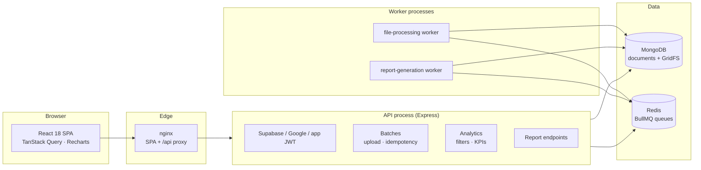

# Batch Financial Processor

Production-minded batch ingestion and analytics for transaction CSVs. Upload up to 20 files, get a
`batchId` immediately, and watch per-file jobs move from `QUEUED` to `COMPLETED` while the dashboard
aggregates IQR statistics, distributions, high-risk activity and data-quality findings. Every batch
can be exported to a multi-sheet Excel workbook.

Built with clean service boundaries: a standalone **Express/MongoDB/BullMQ API & workers service** (`backend/`)
and a standalone **React 18 + Vite dashboard** (`frontend/`), fully decoupled for frictionless deployment.

---

## Deliverables & Submission Links

- **Source Code Repository**: [https://github.com/Devojeet-dev/letsryl-assignment](https://github.com/Devojeet-dev/letsryl-assignment)
- **Live Frontend Dashboard (Render)**: [https://bfdp-frontend.onrender.com](https://bfdp-frontend.onrender.com)
- **Live Backend API (Render)**: [https://bfdp-api.onrender.com](https://bfdp-api.onrender.com)
- **Sample Generated Excel Report**: [`samples/reports/sample-report.xlsx`](samples/reports/sample-report.xlsx) (10 sheets covering Summary, File Status, Field Statistics, Outliers, Distributions, Quality, High Risk, Rejected Rows)
- **Architecture Documentation**: [docs/architecture.md](docs/architecture.md)
- **API Reference**: [docs/api.md](docs/api.md)
- **Analysis & Math Specifications**: [docs/analysis-spec.md](docs/analysis-spec.md)
- **Limits & Retries**: [docs/limits.md](docs/limits.md)
- **Security & Auth Model**: [docs/security.md](docs/security.md)

---

## Contents

- [Architecture](#architecture)
- [Quick start (Docker)](#quick-start-docker)
- [Local development](#local-development)
- [Deployment on Render](#deployment-on-render)
- [Configuration](#configuration)
- [API](#api)
- [Processing semantics](#processing-semantics)
- [Excel report](#excel-report)
- [Tests](#tests)
- [Repository layout](#repository-layout)
- [Operational notes](#operational-notes)
- [Documentation](#documentation)

---

## Architecture



Ingestion is asynchronous and idempotent:

1. `POST /api/v1/batches` validates size/type limits, stores each CSV in GridFS, creates the batch
   aggregate and enqueues one BullMQ job per file (`jobId = fileId`, so a duplicate enqueue is a
   no-op). The response returns the `batchId` before any parsing happens.
2. The `file-processing` worker parses, validates and persists normalized rows plus a per-file
   analysis document. Failures are isolated per file; a bad file never blocks its siblings.
3. Each terminal job triggers a batch-state recomputation: the batch becomes `COMPLETED` when every
   file is terminal, with `partialFailure = true` if any file failed.
4. The dashboard recomputes filtered metrics from persisted rows (bounded by the batch row cap), so
   every KPI, chart and table reacts consistently to the same filter set.
5. Reports are generated on demand by the `report-generation` worker and streamed from GridFS.

More detail, including retry and lifecycle diagrams, lives in [docs/architecture.md](docs/architecture.md).

---

## Quick start (Docker)

```bash
cp .env.example .env      # optional — compose has working defaults
docker compose up --build
```

| Service | URL |
| --- | --- |
| Dashboard | <http://localhost:5173> |
| API | <http://localhost:4000/api/v1> |
| Health / readiness | <http://localhost:4000/health>, <http://localhost:4000/ready> |

Open the dashboard and choose **Continue as demo reviewer** (enabled by `DEMO_AUTH_ENABLED=true` in
compose, which issues a session for a fixed local identity and shares one workspace). For a real
deployment set `DEMO_AUTH_ENABLED=false` and configure Supabase, documented in
[docs/security.md](docs/security.md).

Then upload a few of the provided `transactions_*.csv` files (found in `SumitAssignment/` or `samples/uploads/`)
and open the batch dashboard. A scripted version of this flow is available:

```bash
./scripts/smoke-test.sh            # uploads samples/uploads/*.csv, waits, downloads the report
```

---

## Local development

Prerequisites: Node.js ≥ 20.11, npm 10+, MongoDB 7 and Redis 7 (or `docker compose up -d mongo redis`).

### 1. Backend

```bash
cd backend
npm install
npm run dev              # API on http://localhost:4000
npm run dev:worker       # file-processing worker (separate terminal)
npm run dev:worker:report# report-generation worker (separate terminal)
```

Useful backend scripts:
- `npm run dev` — API on `http://localhost:4000`
- `npm run dev:combined` — Combined API + file worker + report worker in a single process
- `npm run dev:worker` — Standalone file-processing worker
- `npm run dev:worker:report` — Standalone report-generation worker
- `npm run typecheck` — Strict TypeScript checking
- `npm test` — Run all 75 Vitest unit and integration tests across 11 suites
- `npm run build` — Compile TypeScript to `dist/`
- `npm start` — Run production server from `dist/`
- `npm run start:combined` — Run consolidated production API + workers from `dist/`

### 2. Frontend

```bash
cd frontend
npm install
npm run dev              # Vite dev server on http://localhost:3000 (http://localhost:5173 when using Docker)
```

Useful frontend scripts:
- `npm run typecheck` — Validate TypeScript types
- `npm run build` — Build static production bundle into `dist/`
- `npm run preview` — Preview the production bundle locally

---

## Processing semantics

The rules below are enforced by the worker, not the dashboard, and are covered by unit tests.

| Concern | Behaviour |
| --- | --- |
| File limits | 20 files/batch, 10 MB/file, 100 MB/batch, 50,000 rows/file |
| Required columns | `transaction_id`, `customer_id`, `branch_id`, `transaction_type`, `amount`, `balance_after`, `processing_time_ms`, `risk_score`, `transaction_date` |
| Structural failure | `FILE_UNREADABLE`, `UNSUPPORTED_ENCODING` or `MISSING_REQUIRED_COLUMN` (lists the columns) — file-scoped, siblings continue |
| Missing mandatory text | Row rejected, counted per column, sample rows retained |
| Blank numeric | Counted as missing; excluded from that field only — never coerced to `0` |
| Non-numeric value | Counted as invalid with sample row numbers; value becomes `null` |
| Invalid date | Row still contributes to financial metrics but is excluded from date-wise analysis and reported |
| Duplicates | `transaction_id` duplicates are reported with occurrences; **no row is ever dropped** |
| No valid rows | File fails with `NO_VALID_RECORDS` |
| Statistics | Mean, median, min, max, total, sample std-dev (n−1), P25/P75, IQR × 1.5 fences, outliers, 20-bin histogram |
| High risk | `risk_score >= 80`, same threshold used by the dashboard and report |
| Retries | 3 attempts/file (initial + 2), exponential backoff from 2 s; report jobs 2 attempts |
| N/A | Empty samples render as `null` → `N/A` in the UI and workbook |

Exact formulas, quantile method and edge cases: [docs/analysis-spec.md](docs/analysis-spec.md).
Limits and retry rationale: [docs/limits.md](docs/limits.md).

---

## Excel report

`GET /batches/:id/report` returns a streamed `.xlsx` built by the report worker: **Summary**, **File
Status**, **Field Statistics** (batch level plus a section per file), **Distributions**, **Data
Quality**, **By Transaction Type**, **By Branch**, **Date Wise**, **High Risk** and **Rejected
Rows** — ten sheets in total. Missing metrics are written as `N/A`.

A pre-generated example built from `samples/uploads` is committed at
[`samples/reports/sample-report.xlsx`](samples/reports/sample-report.xlsx). Regenerate it without a
database:

```bash
./backend/node_modules/.bin/tsx scripts/generate-sample-report.ts
```

---

## Tests

```bash
cd backend
npm test        # 75 unit & integration tests across 11 suites: CSV structure, row rules, statistics, N/A handling, auth, queue outage
```

Covered: authentication & token lifecycle, queue outage & backpressure (503), strict numeric parsing,
mandatory-field rejection counts, invalid dates, duplicate reporting, sample caps, UTF-8/UTF-16 decoding,
BOM handling, duplicate headers, missing columns, inclusive quantiles, IQR fences, histograms, and null-metric behaviour.

---

## Repository layout

```
backend/               Express API, Mongo/GridFS, BullMQ producers, workers, Excel builder, standalone Dockerfile
frontend/              React 18 + Vite + Tailwind dashboard, standalone Dockerfile & Nginx config
samples/               Reference uploads and generated reports
scripts/               Smoke test and sample report generator
docs/                  Architecture, API, analysis, limits, security, ADRs
SumitAssignment/       Assignment brief PDF and test datasets (20 CSV files)
docker-compose.yml     Local development container stack
backend/render.yaml    Backend service deployment Blueprint for Render
frontend/render.yaml   Frontend static site deployment Blueprint for Render
```

---

## Operational notes

- **Idempotency:** uploads are deduplicated per owner + key for 24 h; per-file jobs are keyed by
  `fileId`; report jobs by `report_<batchId>`.
- **Ownership:** every batch route resolves through the authenticated owner. Another user's batch is
  indistinguishable from a missing one (`404`).
- **Failure isolation:** one malformed CSV fails only its own job; the batch still completes.
- **Backpressure:** uploads fail fast with `503 QUEUE_UNAVAILABLE` when queue depth exceeds
  `QUEUE_MAX_DEPTH`.
- **Graceful shutdown:** API and workers drain on `SIGTERM`; BullMQ `stalled` recovery reaps jobs
  whose worker died mid-flight.
- **Production safety:** Helmet, gzip, strict body/upload limits, Redis rate limiting, request IDs in
  logs and error payloads; no stack traces on the wire.

---

## Documentation

- [Architecture](docs/architecture.md) — components, lifecycles, failure paths
- [API reference](docs/api.md) — endpoints, payloads, error catalogue
- [Analysis specification](docs/analysis-spec.md) — metric definitions and edge cases
- [Limits and retries](docs/limits.md) — guardrails and retry policy
- [Security](docs/security.md) — auth model and demo-mode caveats
- [Decisions](docs/adr/0001-async-batch-processing.md) — key trade-offs
