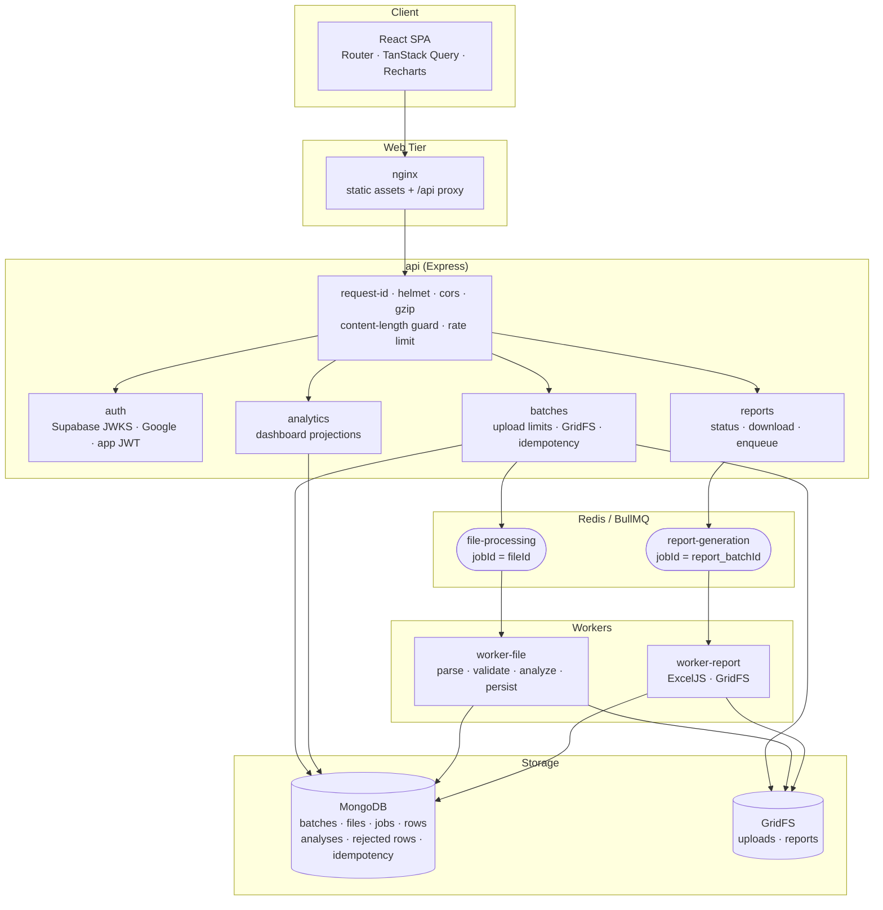
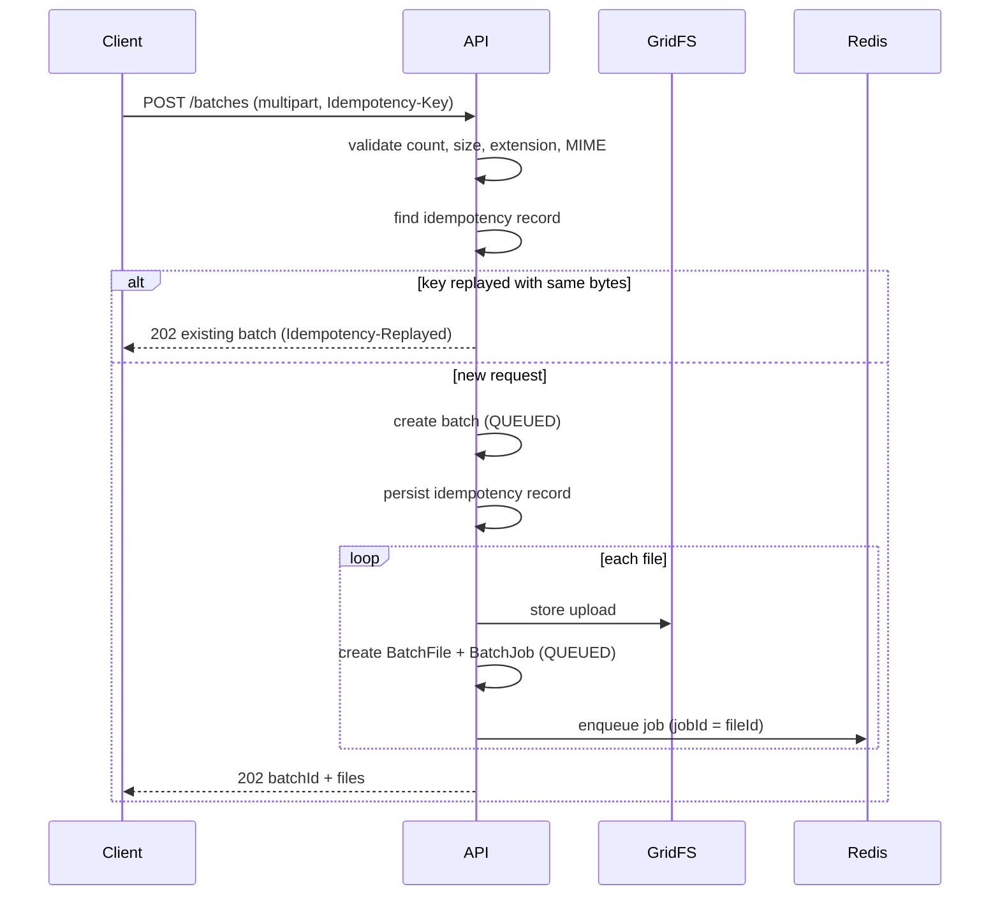
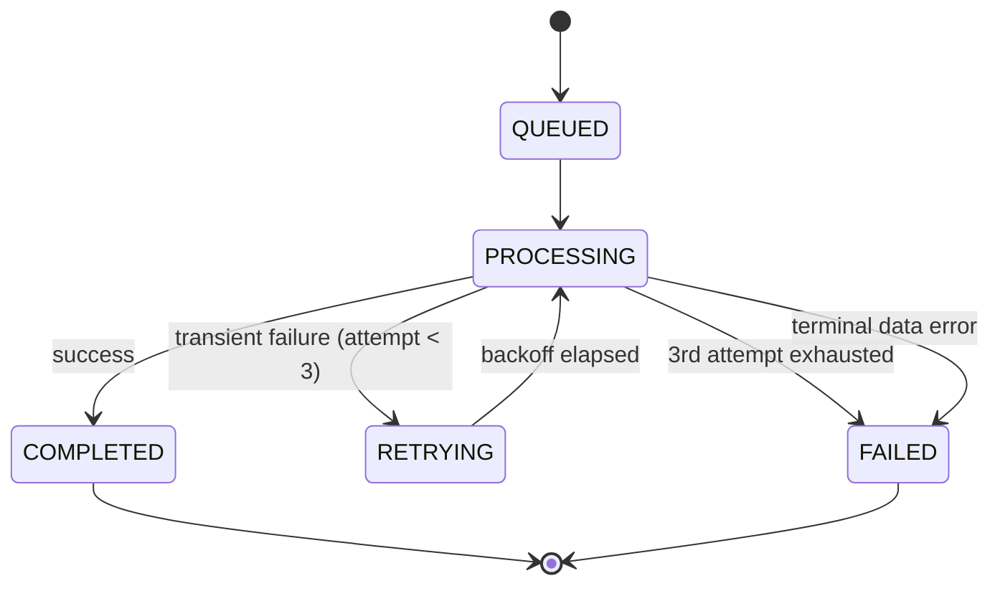
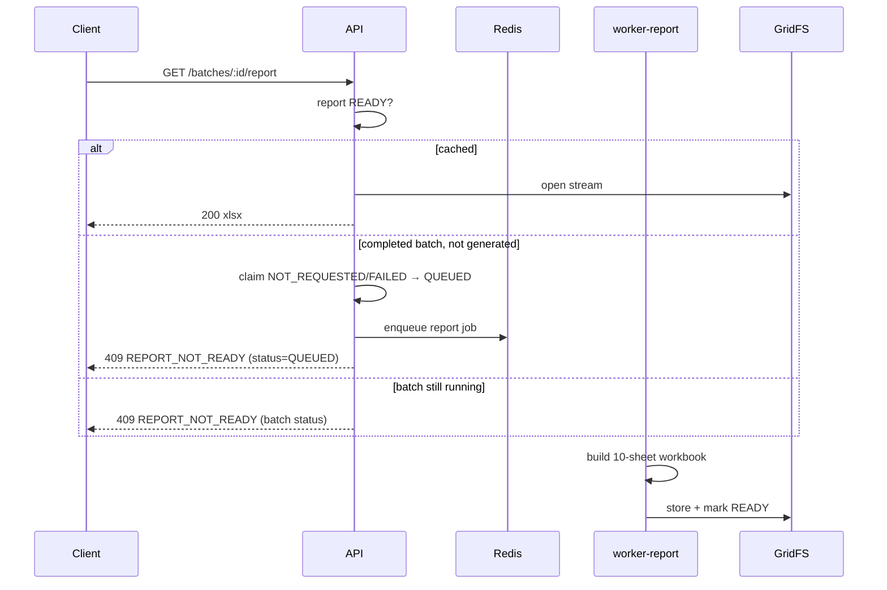

# Architecture

## Component map

The four deployables are independent containers built from two images: one Node image for `api`,
`worker-file` and `worker-report` (command-switched), and one nginx image for the SPA.

## Data model

| Collection | Grain | Notes |
| --- | --- | --- |
| `batches` | one per upload | Owner, status, file/job counts, `partialFailure`, report status |
| `batchfiles` | one per CSV | GridFS id, original name, size, checksum, row counters, failure code |
| `batchjobs` | one per CSV job | Status machine, attempts, timings, error code/message |
| `transactionrows` | one per valid row | Normalized numeric + date fields; indexes on batch/file/branch/type/day |
| `fileanalyses` | one per file | Per-file numeric summaries, histograms, data quality snapshot |
| `rejectedrows` | sampled | Bounded rejection samples for report drill-down |
| `idempotencykeys` | owner + key | 24 h TTL, request hash, batch reference |

`TransactionRow` documents are the source of truth for filtered dashboard metrics; `FileAnalysis`
keeps the unfiltered data-quality snapshot per file. Because a batch is capped at 20 × 50,000 rows,
recomputing aggregates on request stays cheap and supports exact filters without a second pipeline.

## Upload path

The response is returned as soon as jobs are queued; no CSV bytes are parsed in the request path.
Uploads fail fast with `503 QUEUE_UNAVAILABLE` when queue depth exceeds `QUEUE_MAX_DEPTH`, and the
whole request is rejected if any file violates a limit — partial batches are never created.

## Job lifecycle

- Terminal data problems (`FILE_UNREADABLE`, `UNSUPPORTED_ENCODING`, `MISSING_REQUIRED_COLUMN`,
  `NO_VALID_RECORDS`) fail the file immediately — retrying cannot fix the bytes.
- Infrastructure problems are rethrown so BullMQ applies exponential backoff (2 s base, 3 attempts).
  The job is marked `RETRYING` between attempts.
- `transitionJob` is atomic and ignores illegal transitions, because BullMQ can deliver duplicate
  events around restarts.
- The batch flips to `COMPLETED` once every file job is terminal. `partialFailure` is true when at
  least one file failed. One bad CSV never blocks the others.

## Dashboard path

`GET /batches/:id/analytics` authorizes ownership, then in parallel loads the batch, files, jobs,
stored analyses and queue depth. Filters (`fileId`, `branchId`, `transactionType`, `from`, `to`) are
applied to a Mongo query over `transactionrows`; numeric fields, distributions, breakdowns, daily
series, largest transaction and high-risk summaries are all derived from that same row set so the
panels always agree. Filters that select no rows yield `N/A` metrics rather than zeros.

Data-quality counters come from stored per-file snapshots. They describe all files by default and
are narrowed to a single file when `fileId` is supplied; filters that select rows (branch, type,
date) narrow the metrics but leave the quality panel describing the file population it came from.

## Report path

The conditional claim (`status ∈ {NOT_REQUESTED, FAILED} → QUEUED`) makes concurrent GETs safe: only
one enqueue wins. Failed generation records `REPORT_GENERATION_FAILED` and allows a retry via
`POST /batches/:id/report`. Regeneration deletes the superseded GridFS object.

## Failure isolation and recovery

| Failure | Blast radius | Recovery |
| --- | --- | --- |
| Malformed CSV | Single file job | Marked `FAILED`, batch still completes |
| Worker crash mid-job | Single file job | BullMQ stalled-job recovery re-enqueues |
| Mongo/Redis down | API returns 503 via readiness + dependency errors | Restart probes/containers |
| Redis queue full | Upload request only | Client retries after depth drains |
| Report generation error | Report only | `POST .../report` re-queues |
| Duplicate upload | None (idempotent replay) | Original batch returned |

## Why this shape

- **Decoupled standalone services:** `backend/` and `frontend/` operate as fully self-contained projects with their own dependencies, build scripts, and Dockerfiles for straightforward deployment (e.g. on Render, Vercel, or Docker Compose).
- **One job per file:** the assignment's per-file status and retry requirements map directly onto
  BullMQ jobs; isolation also bounds the damage of a poison file.
- **Rows over pre-aggregation:** filters must alter every panel consistently. Persisting normalized
  rows (bounded by the row cap) keeps filters exact while analyses remain a fast per-file cache.
- **Two worker pools:** report generation is CPU-heavy and bursty; keeping it off the file queue
  prevents a large workbook from delaying ingestion.

See [ADR 0001](adr/0001-async-batch-processing.md) for the trade-offs considered.
